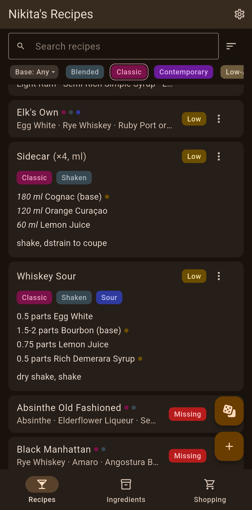
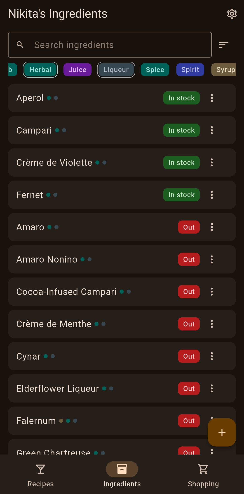
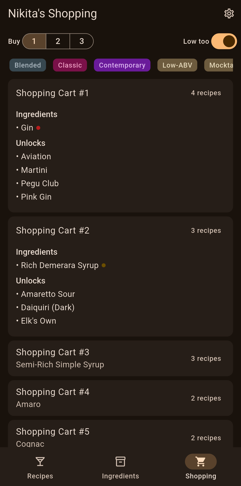
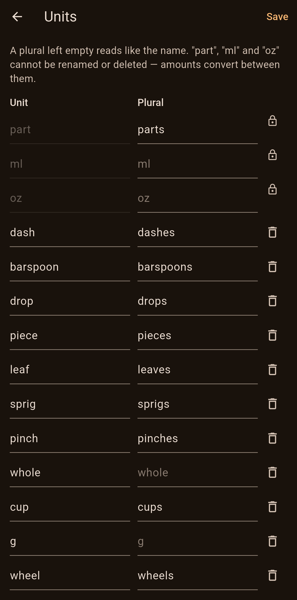
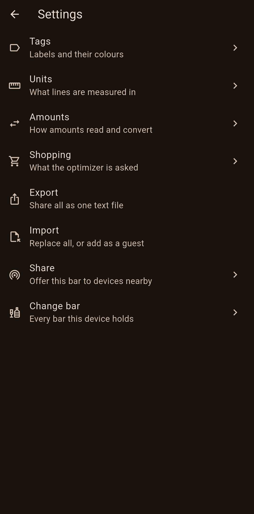

# Cocktails

Personal cocktail recipe and ingredient app — Flutter, Android.

- [Vision](docs/vision.md) · [Requirements](docs/requirements.md) · [Architecture](docs/architecture.md) · [Components](docs/components.md) · [UI design](docs/ui-design.md) · [Roadmap](docs/roadmap.md)

## Screenshots

| Recipes | Ingredients | Shopping | Units | Settings |
| --- | --- | --- | --- | --- |
|  |  |  |  |  |

## Install

No Play Store yet: build the APK and sideload it.

1. Build it, with the [release keystore](docs/architecture.md#build--distribution) in place:

   ```bash
   flutter build apk --release
   ```

2. Get `build/app/outputs/flutter-apk/app-release.apk` onto the phone, one of three ways:
   - **Cable:** enable *Developer options* → *USB debugging*, plug in, then `adb install -r build/app/outputs/flutter-apk/app-release.apk`.
   - **Wi-Fi (Android 11+):** enable *Developer options* → *Wireless debugging* → *Pair device with pairing code*, then `adb pair <ip>:<pairing-port>` and `adb connect <ip>:<port>` (the port on the Wireless debugging screen), and install as above.
   - **No adb:** copy the file to the phone any way you like, open it, and allow *Install unknown apps* for the app that opened it.

Always build with the same keystore: a differently signed APK cannot update the installed app, and uninstalling it deletes every bar on the device.
